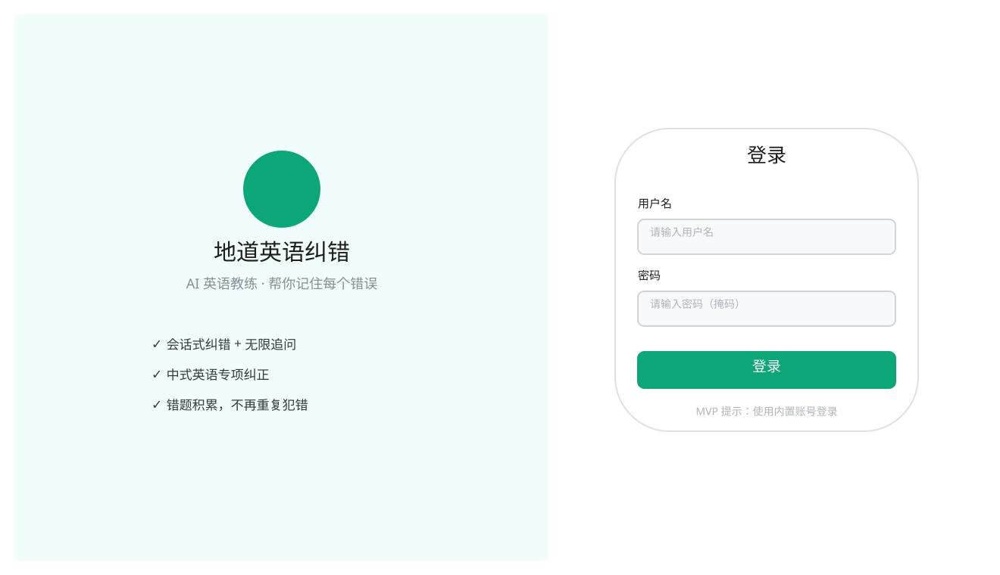
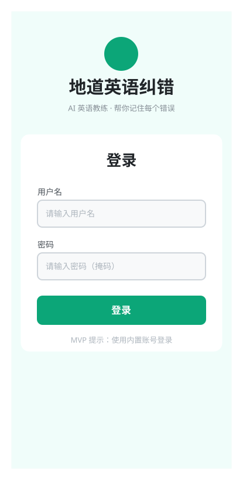

# 登录功能需求文档（01-Login）

**所属**：地道英语纠错 · 智能笔记本 | **版本**：V1.5 | **日期**：2026年8月
**对应功能**：Overview §三 3.1 账号体系（MVP 阶段） | **依赖**：无

> 本文档采用 7 段式 PRD 结构组织，MVP 功能细节（页面结构、校验、三态、验收标准）完整保留于 §4 方案。

## 1. 假设

我们相信提供极简的登录入口（MVP 阶段使用内置固定账号）能让用户快速进入核心纠错流程，从而验证「会话式纠错 + 追问」的核心价值，以**登录成功率接近 100%、登录流程不构成使用门槛**衡量。

## 2. 问题

- **目标用户**：备考学生、职场人士、英语爱好者（详见 `Product-Planning.md` §二 2.1 用户画像），需要登录后才能持久化保存会话纠错记录
- **严重程度**：无账号体系时业务数据无法按用户隔离与持久化，用户离开页面后历史丢失，直接削弱「错题积累」这一核心差异化价值
- **MVP 取舍**：产品处于 MVP 验证阶段，完整账号体系（注册/多用户/找回密码）开发成本高，与当前验证核心价值的目标不匹配
- **如果不做**：无法实现服务端持久化与按账号隔离，核心产品闭环（纠错→记录）无从谈起

## 3. 战略契合

- 登录是进入产品的门槛，也是账号与数据能力（Overview §三）的前置依赖
- 与 Overview §三 3.1 账号体系一致：MVP 采用固定账号验证价值，后续平滑过渡到完整账号体系
- 与 `Product-Planning.md` §五 指标延期约定一致：MVP 阶段（自用优先）不设定成功指标，正式发布前定义

## 4. 方案

### 4.1 MVP 范围

仅内置固定账号（用户名/密码硬编码于服务端），**无注册界面**，无找回密码。

### 4.2 页面目标与入口

- **目标**：提供登录入口，验证用户身份后进入纠错主页
- **入口**：应用根路径 `/` 未登录时重定向至登录页
- **出口**：登录成功后进入纠错主页（`pages/02-Correction.md`）

### 4.3 页面结构

**桌面端（≥768px）**：分栏布局——左侧品牌区（Logo + 标语 + 价值点，~55%），右侧登录卡片（~45%，卡片最大 400px 居中于右侧区域）。

**移动端（<768px）**：整页统一浅青背景（`#f0fdfa`），顶部品牌区（Logo + 品牌名 30px/700 + 短标语）直接铺于背景上；登录表单为白色圆角卡片（圆角 14px + 轻阴影）浮层，左右留边距居中。

> 线框源文件：`wireframes/01-login-desktop.excalidraw`、`wireframes/01-login-mobile.excalidraw`（VS Code 打开即可编辑）；渲染用 SVG 由 `wireframes/convert.mjs` 从源文件生成。约定见 `wireframes/README.md`。

- 响应式遵循移动优先策略（见 §8 响应式设计）
- 无需注册/找回密码入口（MVP）

### 4.4 登录交互

- 用户填写用户名与密码，点击「登录」按钮提交
- 点击后按钮进入**加载态**（禁用 + 指示器），防止重复提交
- 前端做非空校验（见 §4.7），不通过则不发起请求并提示

### 4.5 登录结果反馈

| 场景 | 反馈 |
|------|------|
| 登录成功 | 跳转纠错主页，可给出轻量成功提示（可省略） |
| 用户名或密码错误 | 提示「用户名或密码错误」，输入框内容保留，密码清空 |
| 网络/服务异常 | 提示「登录失败，请稍后重试」，输入内容保留 |

### 4.6 会话保持

- 登录成功后服务端返回会话令牌，前端**持久化保存**（如 localStorage / Cookie）
- 会话有效期内，**刷新页面、关闭并重开浏览器均保持登录态，无需重新登录**；**业务数据（会话消息）存服务端不受影响**（见 Overview §三 3.2）
- 仅在**主动退出登录**或**会话过期**时要求重新登录；会话有效期由服务端控制（如 30 天无活动过期，具体时长由技术选型阶段定义）
- 未登录或会话过期访问任何业务页面，重定向至登录页
- 提供**退出登录**入口（纠错主页导航），退出后清除登录态、业务数据保留

### 4.7 字段与校验

| 字段 | 规则 |
|------|------|
| 用户名 | 必填，非空 |
| 密码 | 必填，非空，掩码输入 |

| 规则 | 触发条件 | 文案 |
|------|----------|------|
| 用户名非空 | 用户名为空提交 | 「请输入用户名」 |
| 密码非空 | 密码为空提交 | 「请输入密码」 |
| 账号密码错误 | 服务端校验失败 | 「用户名或密码错误」 |
| 服务异常 | 请求失败 | 「登录失败，请稍后重试」 |

- 账号验证由服务端完成（内置固定账号）
- 字段类型、接口结构等技术细节由技术选型阶段定义

### 4.8 三态约定

遵循 Overview §二 2.1「全局 UI 状态约定」：

- **加载态**：登录按钮禁用并显示加载指示器
- **空态**：不适用（表单页无列表空态）
- **错误态**：表单区展示错误提示，输入内容保留

### 4.9 账号体系演进规划（后续版本）

| 能力 | 描述 | 目标版本 |
|------|------|---------|
| **注册** | 用户可自助创建账号 | V1.1 |
| **多用户** | 多账号并存，业务数据按账号隔离 | V1.1 |
| **找回密码** | 忘记密码可自助重置 | V1.1 |
| **第三方登录** | 微信/邮箱等快捷登录 | 待定 |

- **平滑过渡**：MVP 固定账号作为首个内置账号迁移到多账号体系；已有会话数据保留在对应账号下
- 与 Overview §三 3.1「后续版本」约定一致

### 4.10 验收标准

- AC-L-01：输入内置账号的合法用户名/密码，点击登录后成功进入纠错主页
- AC-L-02：任一输入为空时点击登录，给出对应提示且不发起请求
- AC-L-03：输入错误密码，提示「用户名或密码错误」，密码框清空、用户名保留
- AC-L-04：登录成功后刷新页面/关闭重开浏览器，登录态保持，无需重新登录（会话有效期内）
- AC-L-05：未登录访问业务页面，自动重定向至登录页
- AC-L-06：页面在手机宽度下正常显示（响应式）
- AC-L-07：退出登录后需重新登录；重新登录后会话数据仍在
- AC-L-08：会话过期后访问业务页面，自动重定向至登录页，需重新登录

## 5. 非目标

- ❌ 不提供注册界面——V1.0 不做，V1.1 起规划（见 §4.9）
- ❌ 不提供找回密码——V1.0 不做，V1.1 起规划
- ❌ 不支持多账号并存——V1.0 仅单一固定账号，V1.1 起规划
- ❌ 不支持第三方登录——目标版本待定
- ❌ 不做「记住我」开关——登录态默认持久保持（会话有效期内），无需用户额外勾选

## 6. 成功指标

MVP 阶段（自用优先）不设定量化指标，延续 `Product-Planning.md` §五 延期约定。正式发布前定义：

- **主指标**：登录成功率（目标 ≈100%）；登录流程完成进入纠错主页的转化率
- **护栏指标**：登录接口 P95 响应时长；会话过期后业务数据完整性
- `[NEED: 来自产品规划的数据]` 指标基线待 Product-Planning 发布准备期补充

## 7. 上线计划

- **MVP 登录**：全量直上（固定账号），随 Phase 1 MVP 开发一并交付（`Product-Planning.md` §三）
- **完整账号体系**：V1.1 起渐进推进，优先「注册 + 多用户」，找回密码/第三方登录逐项排期
- **回滚策略**：登录功能异常时，服务端关闭会话校验可回退到「无需登录直进纠错主页」的降级方案（开发期内部约定，不对外暴露）

## 8. 响应式设计（通用规范）

> 本规范为**全产品通用**的响应式约定，后续页面（如纠错主页）沿用同一套策略与断点。

### 8.1 策略：移动优先

- 以**移动端（窄屏）为基准**设计，再逐步增强到桌面端
- 核心原则：内容优先级不变，仅布局形态随宽度变化
- 每个页面需同时产出**桌面版 + 移动版**两份线框（见 §4.3）

### 8.2 断点

| 断点 | 范围 | 布局形态 |
|------|------|----------|
| **移动端** | `< 768px` | 单列堆叠，满宽留边距（左右各 ≥16px） |
| **桌面端** | `≥ 768px` | 分栏/多列布局，充分利用横向空间 |

- 以**内容宽度**为主、设备宽度为辅判断（如容器最大宽度后居中）
- 断点仅作为布局切换点，不改变交互逻辑

### 8.3 桌面端约定

- 分栏布局：品牌区 / 内容区按功能分配比例（登录页约 55% / 45%）
- 表单卡片最大宽度 **400px**，居中于所在区域
- 合理使用留白，避免内容全宽拉伸

### 8.4 移动端约定

- 品牌区**精简展示**（Logo + 短标语），不铺满全屏、避免滚动
- 表单用**白色圆角卡片浮层**（圆角 14px + 轻阴影），整页浅青背景统一，避免色块硬切
- 品牌名加大加粗，与按钮文字拉开层级（如 30px/700 vs 17px/600）
- 表单/输入控件**满宽留边距**，按钮触控高度 ≥48px
- 不隐藏核心功能，仅做布局重排

---

**变更记录**

- V1.5 · 2026-08 · 移动端重设计：改「整页浅青背景 + 白色圆角卡片浮层」，品牌名 30px/700 与按钮 17px/600 拉开层级；同步 §8.4
- V1.4 · 2026-08 · 登录页改为「桌面分栏 + 移动堆叠」双形态（§4.3，方案 A）；新增 §8 响应式设计通用规范（移动优先 + 768px 断点）
- V1.3 · 2026-08 · 融合 7 段式 PRD 结构重写正文；新增账号体系演进规划（§4.9）与成功指标（§6）；登录态策略改为会话有效期内持久保持（刷新/重开不退出），仅主动退出或会话过期需重登，补充 AC-L-08；MVP 功能细节与其余 AC-L 验收标准保留；同步 Overview V1.6
- V1.2 · 2026-08 · P0 修复：澄清登录态与业务数据持久化关系、补充退出登录入口与 AC-L-07

*本文档将随产品迭代持续更新。*
