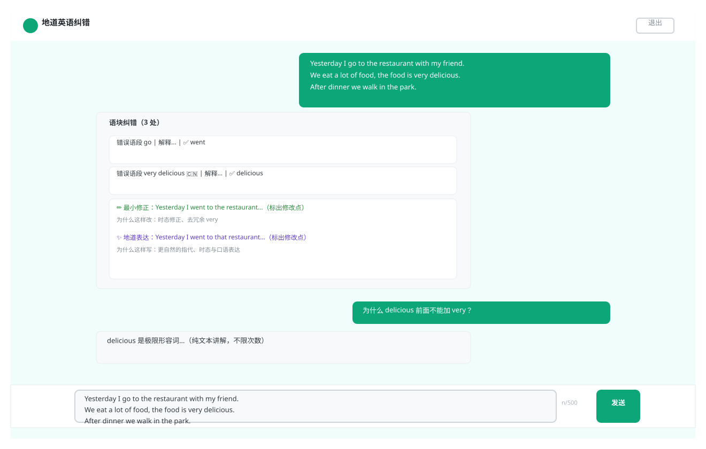
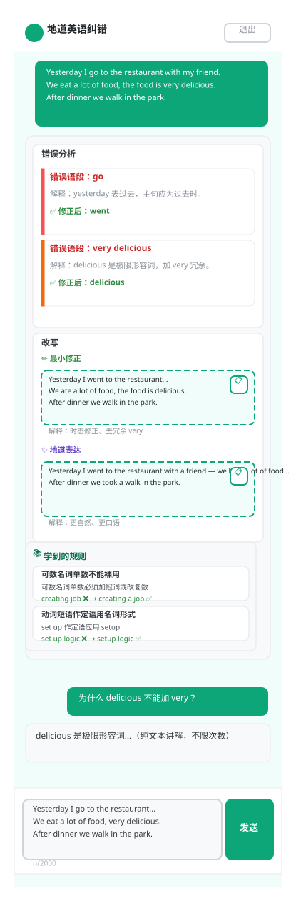

# 会话式文本纠错功能需求文档（02-Correction）

**所属**：地道英语纠错 · 智能笔记本 | **版本**：V2.2 | **日期**：2026年8月
**对应功能**：F-01 会话式文本纠错 | **依赖**：无（本文档为纠错输入/输出约束与错误类型分类的单一事实源）

> 本文档采用 7 段式 PRD 结构（Stage 4 方案评审）。页面结构线框为 Excalidraw 桌面/移动双形态（见 §4.2），视觉方案遵循 `Visual-Style.md`。

> **架构说明**：本页采用**单一大会话窗口**（类似豆包 App）。所有纠错记录与追问按时间正序堆叠于同一个会话流中，天然持续展示全部对话/纠错历史，无需独立的「对话历史页」。

## 1. 假设

我们相信提供「会话式纠错 + 无限追问」的单一大会话窗口，能让用户在获得结构化纠错报告的同时自由深入追问，从而验证「记住每一个错误」的核心价值，以**纠错报告完整返回、追问可连续进行**衡量。

## 2. 问题

- **目标用户**：备考学生、职场人士、英语爱好者（详见 `Product-Planning.md` §二 2.1），需要获得即时、深入、可追问的英文纠错反馈
- **严重程度**：市面工具（如 Grammarly、豆包）能检测语法错误，但普遍「改完就忘」、难以针对个人错误深入讲解；中式英语（语法正确但表达不地道）识别是普遍薄弱环节（见 `Product-Planning.md` §1.2）
- **当前解决方式**：传统纠错工具只给修改建议，无法追问「为什么错」；本产品以会话流让用户对任意一条纠错继续追问，直到弄明白
- **如果不做**：核心差异化价值（结构化纠错 + 深入讲解）无从体现，产品退化为普通语法检查工具

## 3. 战略契合

- 纠错是产品的**核心功能（F-01）**，MVP 唯一交付模块（Overview §一 1.1）
- 与产品愿景「会帮你记住每一个错误的 AI 英语教练」直接对应：纠错报告是后续「记笔记 / 复习」（F-03）的数据来源
- 中式英语专项纠正对齐差异化定位（`Product-Planning.md` §1.3），是区别于 Grammarly / 豆包的突破口
- 与 `Product-Planning.md` §五 指标延期约定一致：MVP 阶段（自用优先）不设定量化指标

## 4. 方案

### 4.1 页面目标与入口

- **目标**：用户在一个持续的会话流中提交英文文本获取纠错，并可对纠错继续追问
- **入口**：登录后默认落地页
- **出口**：无跨页出口（单页会话，除退出登录外）
- **MVP 范围**：仅一个大会话，不提供会话列表、日期分组、会话切换等管理能力

### 4.2 页面结构

**桌面端（≥768px）**：整页浅青背景（`#f0fdfa`），顶部导航（Logo + 产品名 + 退出），会话流消息居中排列（用户消息靠右、AI 回复靠左），底部输入栏横贯（多行输入框 + 字数 n/500 + 发送按钮）。

**移动端（<768px）**：单列堆叠，用户消息与 AI 报告全宽显示，输入栏占满屏幕宽度。

> 线框源文件：`wireframes/02-correction-desktop.excalidraw`、`wireframes/02-correction-mobile.excalidraw`（VS Code 打开即可编辑）；渲染用 SVG 由 `wireframes/convert.mjs` 从源文件生成。约定见 `wireframes/README.md`。

- 桌面端：会话流宽列居中；移动端：全宽单列（响应式规范见 `pages/01-Login.md` §8）
- 进入页面时自动加载全部历史消息（正序），滚动到最底部最新消息
- 视觉方案遵循 `Visual-Style.md` 规范

### 4.3 输入与意图判定

- 单一输入框，支持粘贴或直接输入
- **多行输入**：文本换行时输入框自动延伸增高，不固定单行展示
- **发送方式**：点击「发送」按钮发送
- 实时显示字数统计 `n/500`（含空格与标点）
- 由 **AI 判断用户意图**（结合会话上下文）：
  - 提交内容为「纠正表达」→ 走纠错流程
  - 提交内容为「追问/提问」→ 走对话文本回复
- 产品层兜底规则（仅作判定参考，AI 判断为主）：
  - **纯中文输入** → 判定为追问
  - **英文夹杂中文生词替换**（如 "I went to the 餐厅"）→ 按纠错处理，**不因含中文判定为追问**
  - **疑问句式**（如以 `?` 结尾）→ 由 AI 结合上下文判断，不强制归为追问
- 输入超过 500 字符时：不截断、可继续输入，但字数标红，提示「请将文本缩短至 500 字符以内再提交」，发送按钮禁用
- 输入为空时发送按钮禁用

### 4.4 发送与加载

- 点击「发送」后进入**加载态**：发送按钮禁用 + 加载指示器 + 「AI 正在分析，请稍候…」
- 用户提交的消息立即上屏（占位），AI 返回后在同消息对中追加 AI 回复
- 发送失败时提示「请求失败，请重试」，用户消息保留，可重新发送

### 4.5 纠错消息对：报告呈现

AI 判定为「纠错」时，返回结构化纠错报告（**非流式**，一次性呈现）。

> **说明**：报告内不重复展示原文——原文已在用户提交消息中呈现。报告整体由一个大框包裹，内含两个分区框：「错误分析」「改写」，分区之间有明显的框体区分。

**① 错误分析**（分区框，展示每个错误）

每个错误语块一张卡片，含三要素：

| 区块 | 内容 | 视觉 |
|------|------|------|
| 错误语段 | 出错的原文片段（定位/高亮对象） | 红色 ❌（中式英语附加 🇨🇳→🌍 标识） |
| 错误解释 | 为什么错、为什么这么改 | 灰色说明文字 |
| 修正后（最小修正） | 按**最小修正**原则的修正，保留原结构、只修硬伤 | 绿色 ✅ |

- 卡片三要素**分行展示**（错误语段 → 解释 → 修正后），卡片左侧有彩色条区分（语法错误红条、中式英语品牌色条）
- 语块级仅提供**最小修正**（够用即可），不展开地道进阶表达

**② 改写**（分区框，展示两种整句改法）

| 改法 | 内容 | 视觉 |
|------|------|------|
| 最小修正 | 整合所有最小修正的完整句子，下划线标出改动点 | 绿色 ✏️ |
| 地道表达 | 更自然的整句改写，下划线标出改动点 | 紫色 ✨ |

- 每种改法**虚线框包裹**（浅青底 + 品牌色虚线描边），框内文本支持**多行**展示
- 「解释」说明位于框外下方（灰色小字，如：yesterday 表过去故用 went；delicious 为极限形容词故去 very；用 that restaurant 回指更自然等）
- **复制交互**：每种改法虚线框**右上角内**（距框边 8px 内边距）提供**纯图标复制按钮**（📋，无文字）；点击一键复制框内整段改写文本（含多行），便于用户直接粘贴使用
- 复制成功反馈：按钮变绿色 ✓ + 气泡「已复制」，约 1-2 秒后消失；悬停时按钮描边变品牌色
- **无错误反馈**：AI 判断文本无错误时，展示鼓励文案（见 §7 输出约束），不展示纠错卡片

### 4.6 追问消息对

- 用户可在任意时刻通过输入框发起追问（如「为什么这里用虚拟语气？」「very 为什么不能修饰动词？」）
- 追问**默认关联最近一次纠错报告**，AI 基于该报告上下文回答；如最近无纠错报告，则按通用问答处理
- AI 判定为「追问」时，返回**纯文本解释**回复
- **不限制追问次数**，直至用户无疑问
- **展示方式**：追问为独立用户消息（品牌色高亮、靠右），与普通提交消息样式一致；AI 回答靠左（浅灰底），多轮追问依次堆叠（提问靠右 → 回答靠左）

### 4.7 字段与数据

> 本页涉及的交互数据（提交文本、纠错报告、追问）结构由技术选型阶段定义。产品层面约束如下：

- 会话消息含两类：纠错消息对（提交文本 + 结构化报告）、追问消息对（提问 + 纯文本回复）
- 纠错报告：包含「错误分析」「改写」两个分区（见 §4.5）；报告内不重复展示原文
- 语块定位：AI 返回的错误位置信息需足以让前端精确高亮对应语块
- 改写分区为对照式：最小修正 + 地道表达，均含下划线标注的改动点与「解释」说明，且支持一键复制整段文本（见 §4.5）
- 会话持久化：全部历史消息存储在服务端、按账号隔离，刷新/换设备后仍在（见 Overview §三 3.2）

### 4.8 校验规则与文案

| 规则 | 触发条件 | 文案 |
|------|----------|------|
| 字数上限 | 输入超过 500 字符，字数标红、发送按钮禁用（不截断输入） | 「请将文本缩短至 500 字符以内再提交」 |
| 输入为空 | 空文本点击发送（按钮已禁用，防御） | 「请输入内容」 |
| 请求失败 | 请求异常 | 「请求失败，请重试」；用户消息保留 |
| 超时 | AI 响应超时 | 「AI 响应超时，请重试」 |

### 4.9 三态约定

遵循 Overview §二 2.1「全局 UI 状态约定」：

- **加载态**：发送按钮禁用 + 加载指示器 + 「AI 正在分析，请稍候…」；用户消息先上屏
- **空态**：首次使用无任何消息时，显示引导文案（如「输入英文，AI 将为你纠错；也可以随时提问」）
- **错误态**：请求失败提示 + 「重试」动作，用户消息不丢失

### 4.10 错误类型分类

> 本文档定义错误类型分类的**单一事实源**。

纠错报告中每类错误对应一种分类，页面据此展示类型标签与视觉标识。

| 分类 | 说明 | 视觉标识 |
|------|------|----------|
| 语法 | 时态、主谓一致、冠词、介词、单复数等硬伤 | 红色 ❌ |
| 搭配 | 不地道的词汇组合 | 红色 ❌ |
| 中式英语 | 语法正确但英语母语者不会那样说 | 红色 ❌ + 🇨🇳→🌍 标识 |
| 风格与语气 | 场景化表达优化（MVP 默认日常口语） | 红色 ❌ |

> 颜色规范：错误语段红色、修正后（最小修正）绿色、全句「最小修正」绿色、「地道表达」紫色（与 `Visual-Style.md` 语义色/辅助色一致）；中式英语语段附加 🇨🇳→🌍 标识。

### 4.11 验收标准

- AC-C-01：提交文本后，等待完整纠错报告一次性呈现，不流式输出
- AC-C-02：用户提交消息中的错误语块按 AI 定位信息精确高亮（下划线/颜色），位置正确；报告内不重复展示原文
- AC-C-03：每个语块卡片包含错误语段、错误解释与修正后（最小修正）三要素
- AC-C-04：语法正确但不地道的表达，语块带 🇨🇳→🌍 标识；更地道的改写呈现于改写分区「地道表达」
- AC-C-05：改写分区以对照式展示「最小修正」与「地道表达」，下划线标出修改点，各附「解释」说明
- AC-C-06：输入超过 500 字符时，字数标红且发送按钮禁用，输入内容不截断
- AC-C-07：无错误文本展示鼓励文案
- AC-C-08：请求失败时用户消息保留，可重试
- AC-C-09：提交纯中文内容时返回纯文本追问回复，不生成纠错报告
- AC-C-10：追问不限次数，连续多次追问均可正常回复
- AC-C-11：进入页面加载全部历史消息，正序排列（最新在下），刷新后仍在
- AC-C-12：旧消息仅可回看，不可重新提交或修改
- AC-C-13：发起追问时，AI 回复基于最近一次纠错报告上下文
- AC-C-14：输入多行文本时输入框自动延伸增高，不固定单行展示
- AC-C-15：点击改写分区「最小修正/地道表达」虚线框右上角的复制按钮，可一键复制框内整段文本（含多行）；复制成功有「已复制」反馈

## 5. 非目标

- ❌ 不做**流式输出**——纠错报告一次性完整呈现，非流式（刻意取舍，保证报告结构完整可读）
- ❌ 不做**会话管理**——无会话列表、日期分组、会话切换、删除（V1.0 不做，后续增强）
- ❌ 不做**记笔记**——一键记笔记功能后期版本增加，纠错报告作为其数据来源
- ❌ 不做**语音输入**——V1.0 仅文本输入
- ❌ 不做**学习报告/周报月报**
- ❌ 不做**场景切换**（雅思写作/商务邮件等场景模板）——V1.0 默认日常口语，V1.1 规划（Overview §一 1.2）
- ❌ 不做**错题复习**——依赖记笔记数据，随记笔记功能一并排期（Overview §一 1.2）

## 6. 成功指标

MVP 阶段（自用优先）不设定量化指标，延续 `Product-Planning.md` §五 延期约定。正式发布前定义：

- **主指标**：纠错报告完整返回率；追问继续率（发起追问后用户继续会话的比例）
- **护栏指标**：纠错响应时长（MVP 以「能完整返回报告为准」，不设 SLA）；历史消息加载完整性
- `[NEED: 来自产品规划的数据]` 指标基线待 Product-Planning 发布准备期补充

## 7. 输入与输出约束

### 7.1 输入约束

| 约束 | 规则 |
|------|------|
| 单次提交文本上限 | **500 字符**（含空格与标点） |
| 超限处理 | 输入超过 500 字符不截断、可继续输入；字数标红 + 发送按钮禁用 |
| 输入语言 | 以英文为主，允许英文句子中夹杂个别中文生词替换（按纠错处理）；纯中文输入按追问处理 |
| 超限提示文案 | 「请将文本缩短至 500 字符以内再提交」 |

### 7.2 输出约束

- 当 AI 判断文本无错误时，返回鼓励性反馈文案：「🎉 这段英文写得不错，没有发现语法或不地道的表达！」仍可继续提交。

## 8. 上线计划

- **MVP 纠错**：全量直上，随 Phase 1 MVP 开发一并交付（`Product-Planning.md` §三），为 MVP 唯一功能模块
- **后续迭代**：记笔记 / 复习（F-03）随记笔记功能回归后一并排期
- **回滚策略**：AI 服务异常时，保留「请求失败，请重试」重试机制；纠错报告结构与错误分类为版本化契约，变更需联动前端解析

---

**变更记录**

- V2.2 · 2026-08 · §4.5 报告重构为「整体大框 + 错误分析/改写两分区」；改写分区「最小修正/地道表达」虚线框包裹，右上角复制按钮一键复制整段文本；新增 AC-C-15
- V2.1 · 2026-08 · §4.2 页面结构线框由 ASCII 替换为 Excalidraw 双形态（桌面/移动），遵循 Visual-Style.md
- V2.0 · 2026-08 · 展示与交互修订：报告内不重复展示原文；全句总结改「对照式」（下划线标出修改点，最小修正绿/地道表达紫，每行附为什么说明）；追问改独立消息对（提问靠右/回答靠左）；输入框多行自动延伸；新增 AC-C-14
- V1.9 · 2026-08 · 撤销回车发送（仅点击发送按钮）；取消超 500 字自动截断，改为「标红 + 发送按钮禁用、不截断输入」；删除 AC-C-14，AC-C-06 修订
- V1.8 · 2026-08 · 交互与报告细节修订：语块卡片改为「错误语段 / 错误解释 / 修正后（最小修正）」三要素，语块级不展开地道表达；全句总结强调「解释为什么这样写」
- V1.7 · 2026-08 · 重写为 7 段式 PRD（Stage 4 方案评审）；功能范围、错误分类、约束与 AC-C 验收标准保留；页面结构线框沿用 ASCII（视觉方案后续单独设计）
- V1.6 · 2026-08 · P0 修复：移除「新纠错」与「错题笔记」导航、删除记笔记交互（§3.5/3.6）、追问默认关联最近纠错、意图判定改为 AI 判断为主（支持英文夹杂中文生词）、AC 重编号

*本文档将随产品迭代持续更新。*
